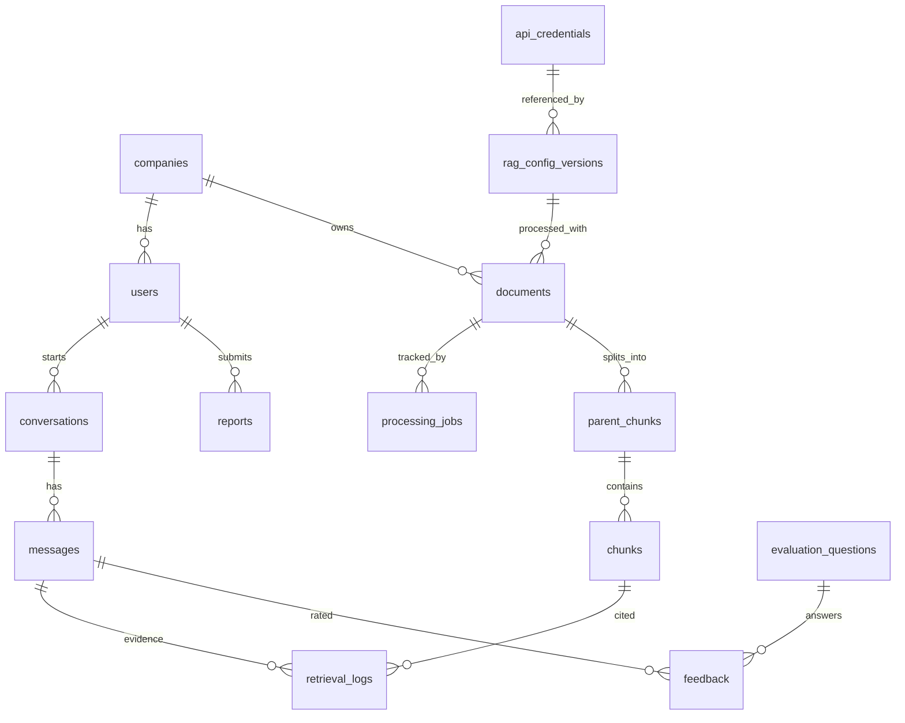
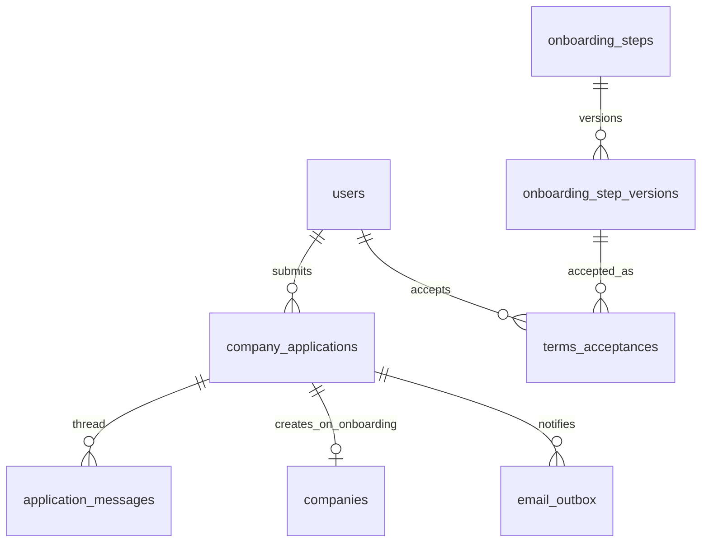
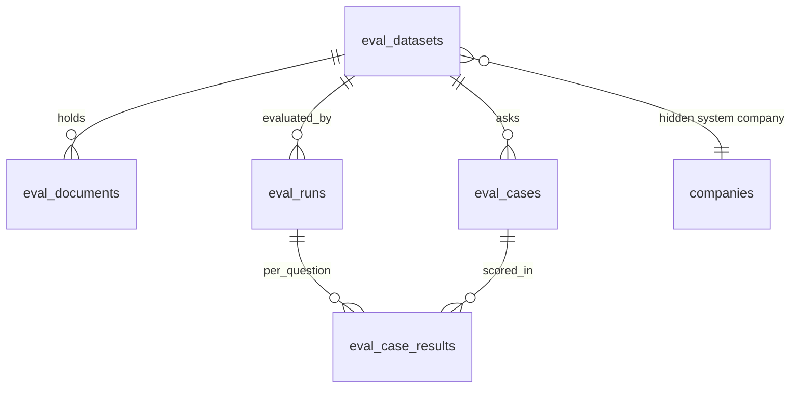

# Database Design

PostgreSQL 16 + pgvector. Source of truth: [`schema.sql`](./schema.sql) (fresh installs). Existing databases are upgraded with [`migrations/002_onboarding_multilingual.sql`](./migrations/002_onboarding_multilingual.sql) (safe to re-run), then [`migrations/003_model_evaluation.sql`](./migrations/003_model_evaluation.sql). 33 tables.

## ER overview

## Tables

| Table | Purpose | Key columns |
|---|---|---|
| `companies` | Tenants | `access_status` (SuperAdmin on/off), `chatbot_state` (not_started/started/paused/ended), `kb_status` (empty/processing/ready/failed) |
| `users` | All three roles | `role`, `company_id` (NULL only for super_admin), `email` CITEXT unique, `password_hash`, `status` |
| `api_credentials` | Encrypted API keys | `encrypted_key` BYTEA, `key_last4` (only thing the UI sees) |
| `rag_config_versions` | Versioned global RAG settings, one JSONB per RAG part | `status` (draft/active/failed/archived); partial unique index = exactly one `active` |
| `evaluation_settings` | Singleton: ask feedback every N answers | `every_n_answers`, `enabled` |
| `evaluation_questions` | Feedback form | `type` (rating_1_5 / true_false), `position`, `is_active` |
| `documents` | Uploaded files | `status`, `content_hash` (dedupe per company), `config_version_id` |
| `processing_jobs` | Pipeline progress | `stage`, `status`, `progress_pct`, `error_message` (safe) vs `error_detail` (logs), `eda_stats` JSONB |
| `parent_chunks` | Large context blocks sent to the LLM | `content`, `page_number` |
| `chunks` | Child chunks: embedded + keyword-indexed | `embedding vector(768)` (HNSW cosine), `tsv` (GIN), `parent_id` |
| `conversations` | Chats | `exchange_count` with `CHECK <= 9` |
| `messages` | Q and A rows | `exchange_no`, `has_evidence`, `normalized_question`, tokens, latency, `error_code` |
| `retrieval_logs` | Question -> answer -> evidence trace | dense/sparse/fused scores, rank |
| `feedback` | Per-question employee answers | `rating` 1-5 XOR `bool_value` |
| `reports` | Issues / recommendations | `type`, `comments`, `status` |
| `deletion_jobs` | Tracks "End service" deletion | per-step JSON status, `attempts`, no FK so it survives company deletion |
| `audit_logs` | Admin actions (never secrets) | `action`, `actor_id`, `details` |
| `error_logs` | Protected technical logs | `source`, `error_code`, `detail` |

## Isolation (three layers)
1. Every tenant row carries `company_id` (chunks, parent chunks, messages, feedback, reports...).
2. Backend derives `company_id` from the JWT, never from request input, and scopes every query.
3. RLS policies on all tenant tables, forced, using `app.current_company_id`. The API connects as `rag_app` (non-owner) so policies apply.

## Key design decisions
- **768 dimensions**: `gemini-embedding-001` outputs 3072 by default but supports reduced dimensions; pgvector HNSW indexes cap at 2000 for `vector`. 768 is a good quality/size tradeoff. Changing it later requires re-embedding.
- **Parent-child**: children are searched, parents are sent to the LLM. Other strategies simply leave `parent_id` NULL.
- **Hybrid search**: dense via `embedding <=> query`, sparse via `tsv @@ websearch_to_tsquery`, fused with Reciprocal Rank Fusion in the backend. Reranker/query-transform slots already exist in `retrieval_cfg`.
- **Config safety**: new config is saved as `draft`, validated (live test call), then promoted to `active` in one transaction; on failure it becomes `failed` and the old one stays active.
- **Chat limit**: enforced in the API (value from `chat_cfg.max_exchanges`) plus a DB CHECK as a safety net.

## v1.1 additions (company onboarding, CMS content, languages)

| Table | Purpose |
|---|---|
| `company_applications` | A company's request to join. `status`: pending, needs_info, approved, rejected, onboarded. Answers are stored as JSONB, `company_name` is denormalised for lists. Unique partial index `uq_one_open_application`: one open request per applicant; a new one is allowed after rejection. |
| `application_messages` | The conversation between applicant and reviewer (submission, info_request, response, approval, rejection, comment, status). |
| `application_form_fields` | The request form itself (label, type, options, required, order). System fields (company_name) cannot be removed. |
| `onboarding_steps` + `onboarding_step_versions` | Walkthrough pages (guidelines, privacy summary, terms). Every edit creates an immutable version; `current_version_id` points to the live one. |
| `terms_acceptances` | Who accepted which exact version, when, from which IP/browser. |
| `site_content` | Landing-page sections as JSONB (`title`, `subtitle`, `body`, `items[]`). |
| `languages` | Supported languages: detection words (`stopwords`), sample sentences for the language check, enabled flag. Adding a language is a row, not code. |
| `email_outbox` | Queue of outgoing emails (pending / sent / failed / skipped when SMTP is not configured). |
| `anonymised_feedback` | De-identified rating scores and report categories kept after a company ends service. No company, user, question, answer or comment text. |

Changes to existing tables
- `users.role` gains `applicant`; the CHECK `user_company_rules` allows applicants (and super admins) without a company. An applicant becomes `company_admin` when onboarding completes.
- `chunks.tsv` now indexes raw tokens (`simple`) plus English stems, so keyword search works for English and Kinyarwanda.
- `messages.language` stores the detected language of each question.
- `documents.embedding_model` records which model made a document's vectors. Dense search only compares vectors of the same model; changing the model re-queues every document.
- `deletion_jobs` gains an `anonymize` step that runs before deletion.

Company is created **when the applicant accepts the terms** (not when the reviewer approves), so no workspace exists until the terms are accepted.

## v1.2 additions (model evaluation lab)

| Table | Purpose |
|---|---|
| `eval_datasets` | A benchmark: name, description, `is_starter`, and the hidden system company that holds its processed chunks. |
| `eval_documents` | Benchmark files (language, storage path) and `ingest_fingerprint` (the cleaning + chunking + embedding settings used), so documents are re-processed only when those settings change. |
| `eval_cases` | Questions: language, document language, `answerable` (FALSE tests the "could not find it" behaviour), expected answer, `evidence` (verbatim phrases = retrieval ground truth), `key_facts` (what a correct answer must contain). |
| `eval_runs` | One evaluation: `kind` (retrieval or llm), `params` (mode oracle / pipeline / closed_book), `config_snapshot` (the exact RAG settings evaluated), progress, `summary` JSONB with every aggregate metric. |
| `eval_case_results` | Per-question metrics and details (the retrieved list with relevant flags, or the answer and judge verdict). |

`companies.is_system` marks the hidden workspaces that hold benchmark documents: they are excluded from every company list and from platform analytics, so evaluation data never mixes with customer data. Fresh installs (`schema.sql`) and upgraded databases (migrations 002 + 003) were verified to produce identical schemas (321 columns, 74 indexes, 115 constraints, 0 differences).
