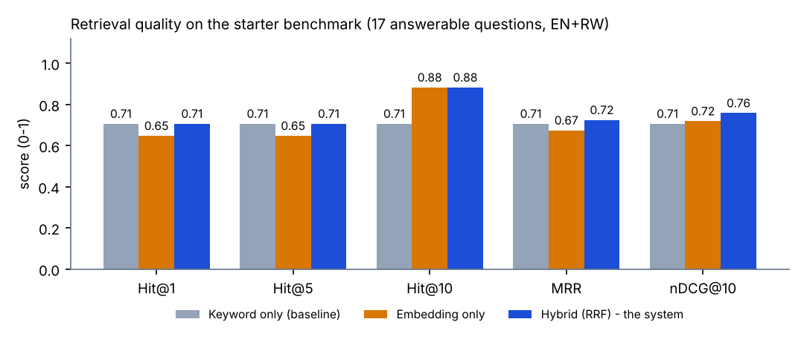
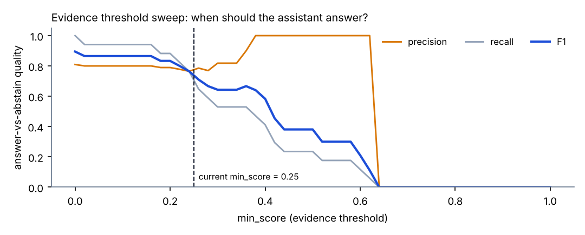
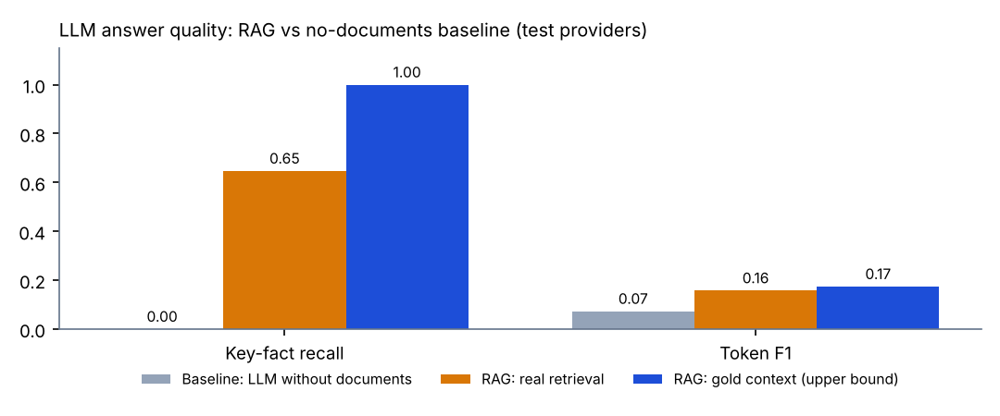

# Model Evaluation Metrics - Explanation Guide

**What this document is.** The Company RAG Chatbot has two AI parts that can fail in different ways: the **embedding + retrieval** part (finding the right passage) and the **LLM** part (writing a correct answer from that passage). The SuperAdmin page **Model evaluation** measures each part on its own, so a bad answer can be traced to the part that caused it. This guide explains every number on that page: what it measures, the formula, how to read it, and what to change when it is low.

> **Honesty note.** The numbers shown in this guide come from the built-in *test providers* (a deterministic hashing embedder and a scripted LLM) so the results are reproducible without an API key. They prove the evaluation machinery works; they are **not** a measurement of Gemini quality. The same runs, started from the SuperAdmin page with the Gemini configuration, produce the real figures to quote in the presentation.

## 1. Why two separate evaluations

```
question -> [ embed + retrieve ] -> passages -> [ LLM writes answer ] -> answer
              evaluated by the RETRIEVAL run        evaluated by the LLM run
```

If the answer is wrong, either the right passage was never found (retrieval problem) or it was found but misused (LLM problem). Two runs on the same questions answer "which one?":

| Run | Question it answers | Needs documents? |
|---|---|---|
| **Retrieval / embedding** | Does the correct passage appear near the top of the results? | Yes (benchmark documents) |
| **LLM - oracle mode** | Given the *correct* passage, does the LLM answer well? (isolates the LLM) | Yes |
| **LLM - pipeline mode** | End to end: real retrieval, then the LLM | Yes |
| **LLM - closed-book mode** | What does the LLM know *without* the documents? (the baseline) | No |

Reading them together: *oracle minus pipeline* = quality lost to retrieval. *oracle minus closed-book* = value the documents add.

## 2. The benchmark (what is being tested)

A **dataset** = documents + questions. Each question records: the question text and language (English or Kinyarwanda); whether it is **answerable** from the documents; **evidence phrases** (text that must appear in a correct passage); **key facts** (words the correct answer must contain; `a|b` lists accepted alternatives); and an optional reference answer. The built-in **starter benchmark** has 4 documents and 21 questions: 17 answerable and 4 deliberately unanswerable, across English->English, Kinyarwanda->Kinyarwanda and both cross-language directions. The SuperAdmin can add datasets, upload documents, add/import/export questions (JSON) and delete them. Evaluation documents live in a hidden `[System]` workspace, so they never appear as a customer and are never mixed into customer data.

**How "relevant" is decided.** A retrieved chunk is *relevant* when it contains the evidence phrase (exact match after lower-casing and removing punctuation and apostrophe variants; phrases of five or more words also pass at 85% word overlap, which tolerates chunk overlap and formatting). This is automatic and repeatable, with no human labelling per run.

## 3. Embedding and retrieval metrics

Every metric is computed over the **answerable** questions, on the ranked list the system returns (top 10). Let `rank` be the position of the first relevant chunk.

| Metric | Formula | Plain meaning | How to read it |
|---|---|---|---|
| **Hit@k** | 1 if any of the top *k* is relevant, else 0; averaged | "Is the answer somewhere in the top k?" | Hit@5 is the headline. Below 0.8 means users will often get "not found" or a wrong answer. |
| **Precision@k** | relevant in top *k* / *k* | How clean the top *k* is | Naturally low when only one passage is correct (max 1/k). Use to compare settings, not as a goal. |
| **Recall@k** | relevant in top *k* / all relevant | Share of correct passages found | Matters when an answer needs several passages. |
| **MRR** | mean of 1/rank | Rewards putting the answer first | 1.0 = always first. 0.5 = typically second. |
| **nDCG@10** | DCG / ideal DCG, with DCG = sum of rel / log2(position+1) | Ranking quality with a position discount | Closer to 1 is better; sensitive to order, unlike Hit@k. |
| **MAP** | mean of average precision | Quality over the whole list | Equals MRR when there is one relevant passage. |
| **95% interval (Wilson)** | Wilson score interval for a proportion | Uncertainty from a small test set | With 17 questions an interval is wide (for 12/17 correct: 0.47-0.87). Do not over-read small differences. |

### 3.1 Three retrieval modes, side by side (the ablation)
The same questions are run through **embedding only** (dense: this isolates the embedding model), **keyword only** (sparse: a no-AI baseline) and **hybrid** (what the product uses: both lists merged by Reciprocal Rank Fusion). Hybrid should be at least as good as the better single method; if it is not, the fusion settings need attention.



| Mode (starter benchmark, test providers) | Hit@1 | Hit@5 | Hit@10 | MRR | nDCG@10 |
|---|---|---|---|---|---|
| Keyword only | 0.706 | 0.706 | 0.706 | 0.706 | 0.706 |
| Embedding only | 0.647 | 0.647 | 0.882 | 0.674 | 0.718 |
| **Hybrid (RRF)** | **0.706** | **0.706** | **0.882** | **0.724** | **0.758** |

*Reading this table honestly:* hybrid has the best MRR and nDCG and the best Hit@10, which is the expected benefit of fusion (keyword catches exact words, embeddings catch meaning). The *embedding-only* weakness here is a property of the **test hashing embedder**, which only matches identical words. Real Gemini embeddings are expected to do better on paraphrases; only a real run can show how much.

### 3.2 Other retrieval diagnostics
| Diagnostic | What it measures | Result in this run |
|---|---|---|
| **Evidence integrity** | Share of answerable questions whose evidence text survives *intact* inside at least one chunk. It tests cleaning + chunking: if chunking cuts the answer in half, no retriever can recover it. | 1.00 (95% CI 0.82-1.00) |
| **Context recall: child vs parent** | Does the larger parent passage (sent to the LLM) contain the evidence more often than the small child chunk used for search? Shows whether parent-child chunking helps. | 0.706 vs 0.706 (documents in the starter set are short, so parents add nothing; the gap appears with long documents) |
| **Cross-language gap** | Hit@5 for same-language questions minus Hit@5 for cross-language questions (English question, Kinyarwanda document and the reverse). | 0.917 vs 0.000 for the test embedder (it has no multilingual knowledge). The real multilingual model must close this gap; it is the key number for the Kinyarwanda requirement. |
| **By language pair** | The same metrics split into en->en, rw->rw, en->rw, rw->en. | Shown per pair on the page |
| **Latency** | p50 / p95 time of the dense and keyword searches. | dense p50 1.2 ms, keyword p50 0.5 ms |
| **Chunk statistics** | Number of chunks, average / median / p95 length. | 16 chunks, 6 parents, mean 147 characters |

### 3.3 The "no answer" decision (threshold analysis)
The assistant answers only when the best match is similar enough (`min_score`); otherwise it says "I could not find this". Choosing the value is a trade-off, and the page sweeps it from 0 to 1 in steps of 0.02, treating *answerable* as the positive class:

- **Precision** = of the questions it chose to answer, how many truly were answerable (a low value = it answers things it should refuse, risking invented answers).
- **Recall** = of the answerable questions, how many it chose to answer (a low value = it refuses things it could have answered).
- **F1** = 2 x precision x recall / (precision + recall). The page suggests the threshold with the best F1 (the middle of a plateau if several tie).



*In this run* the suggested value is 0.0 and the separation between answerable (mean 0.354) and unanswerable (mean 0.320) questions is tiny: the test embedder cannot tell them apart, and the page says so by showing a flat curve. With real embeddings the two groups should separate and the curve should have a clear peak. **Set `min_score` from the real run, not from this table.**

## 4. LLM metrics

| Metric | How it is computed | What it tells you |
|---|---|---|
| **Key-fact recall** | Share of the required key facts that appear in the answer (deterministic) | Did the answer contain the facts (numbers, names)? The most objective answer metric. |
| **Token F1** | Word-overlap F1 between answer and reference (SQuAD style) | Similarity to a reference. Low for long, polite answers even when correct, so use it to *compare runs*, not as an absolute grade. |
| **Faithfulness** | LLM-as-judge: supported claims / total claims, against the context given | Does the answer stay inside the documents (no invention)? |
| **Relevance** | LLM-as-judge score 0-5, shown as a share of 5 | Does the answer address the question asked? |
| **Language match** | Detected answer language equals the question language | Does a Kinyarwanda question get a Kinyarwanda answer? |
| **Abstention accuracy** | On unanswerable questions, share where the assistant correctly said it could not find the answer | Does it refuse instead of guessing? |
| **False-abstention rate** | On answerable questions, share where it wrongly refused | Is it too cautious? |
| **Latency, tokens** | Time and tokens per answer | Cost and speed. |



| Mode (test providers) | Key-fact recall | Token F1 | Faithfulness | Language match | Abstention accuracy | False abstention |
|---|---|---|---|---|---|---|
| Closed-book baseline | 0.000 | 0.073 | not judged | 1.00 | 0.00 | 0.00 |
| RAG - real retrieval | 0.647 | 0.158 | 1.00 | 1.00 | 0.00 | 0.235 |
| RAG - gold context (oracle) | 1.000 | 0.174 | 1.00 | 0.76 | 1.00 | 0.00 |

*Reading it:* the baseline scores 0 on key facts, so **documents are what make the answers correct**. The gap from oracle (1.00) to real retrieval (0.65) equals the retrieval losses seen in section 3 (11 of 17 answered). The scripted test LLM is not a real model; the abstention row for real retrieval shows the cost of the weak test embedder (all four unanswerable questions looked "answerable"). Faithfulness here is trivially 1.0 because the test LLM copies its context.

## 5. Which setting to change when a number is low

| Symptom | Likely cause | Change (SuperAdmin > RAG settings) |
|---|---|---|
| Hit@5 low, evidence integrity high | Embedding or fusion weak | Try another embedding model; raise `top_k`; check sparse retrieval is on |
| Evidence integrity low | Cleaning/chunking cuts answers | Increase chunk size or overlap; switch strategy; check cleaning options |
| Hit@5 fine, key-fact recall low in oracle mode | LLM problem | Improve the system prompt; lower temperature; raise `max_output_tokens` |
| Oracle high, pipeline low | Retrieval problem | See the first row |
| Cross-language gap large | Embedding not multilingual | Use `gemini-embedding-2`; run the Language check |
| Too many wrong answers to out-of-scope questions | `min_score` too low | Use the suggested threshold from the sweep |
| Too many "not found" for valid questions | `min_score` too high | Lower it |
| Language match low | Prompt or language detection | Edit the language instruction; add stop-words for the language |

## 6. How to run it (real models)
1. SuperAdmin > **RAG settings**: set the real Gemini embedding and LLM, activate (the system validates with a live call first).
2. SuperAdmin > **Model evaluation**: open the starter benchmark, press **Run retrieval evaluation**; when it finishes press **Run LLM evaluation** in modes *oracle*, *pipeline* and *closed-book*. On the free tier set a pause of 4-12 seconds between calls.
3. Open a run to see every metric, the per-question table (which question failed and which passage was returned), the settings snapshot, and **Export CSV**.
4. Change one setting at a time, run again and compare (each run stores its exact settings).
5. To grow the benchmark: add your own company documents and questions (**Import** JSON). Aim for at least 50 answerable questions per language before drawing conclusions.

The same runs can be reproduced offline with `python backend/tests/collect_eval_results.py`, which writes `docs/testing/results/eval_results_test_providers.json`.

## 7. Limitations (state these when presenting)
- **Small starter set** (21 questions): intervals are wide, so differences of a few points are noise.
- **Test providers** were used for the figures above; the real Gemini numbers must come from the SuperAdmin page.
- **Relevance by phrase matching** can miss a correct passage that is paraphrased, and can credit a passage that merely quotes the phrase.
- **LLM-as-judge** is imperfect and may favour its own model family; for that reason the deterministic metrics (key-fact recall, token F1, language match) are always shown beside the judged ones.
- **Token F1** penalises correct but wordy answers.
- Results describe *this* benchmark, not every possible company document set.
