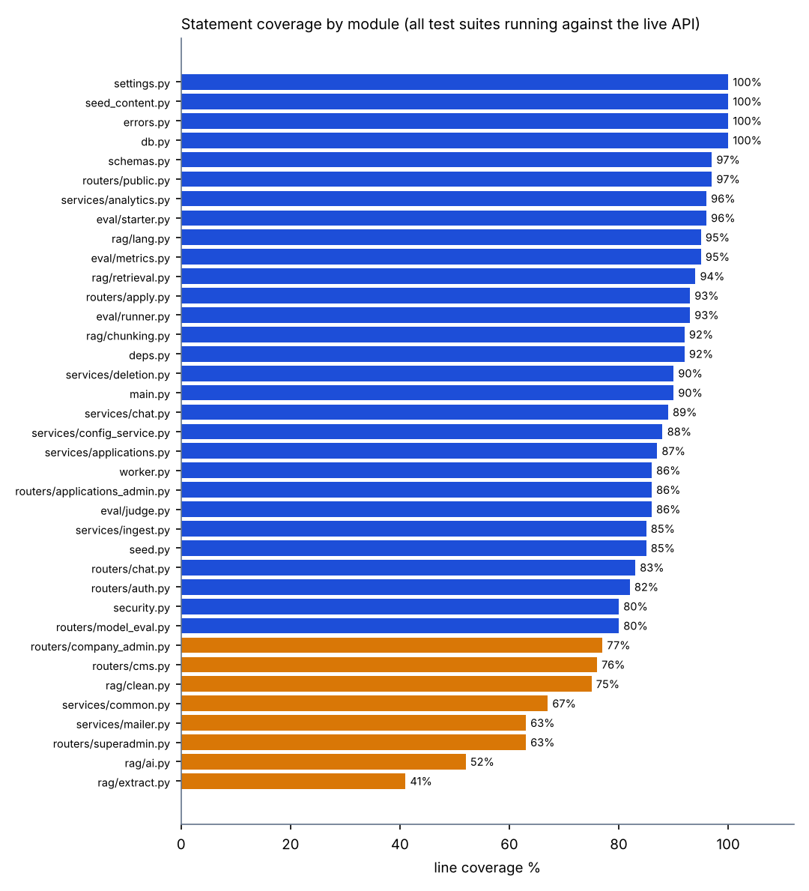
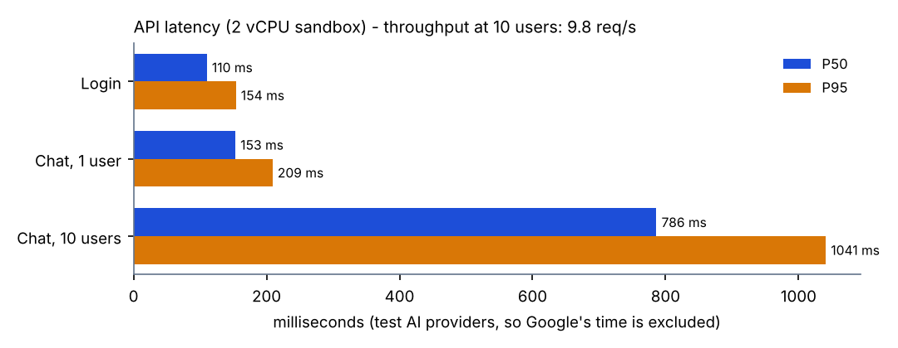
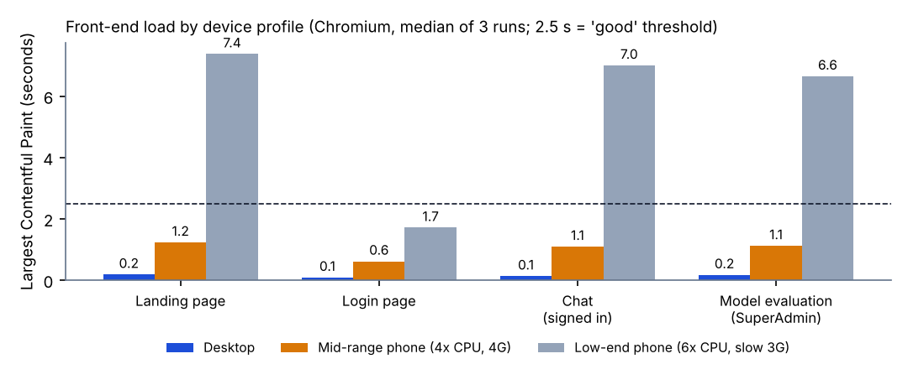
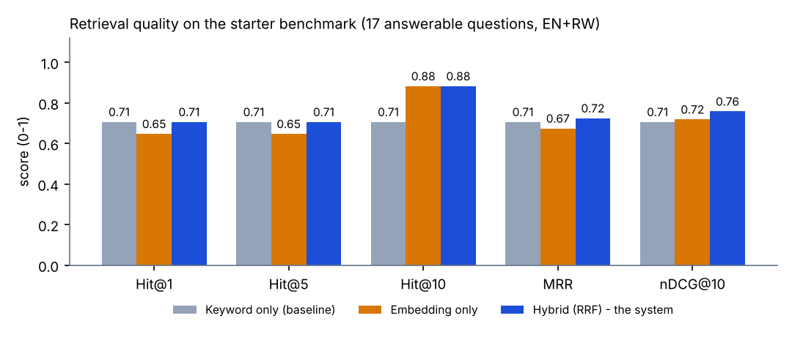
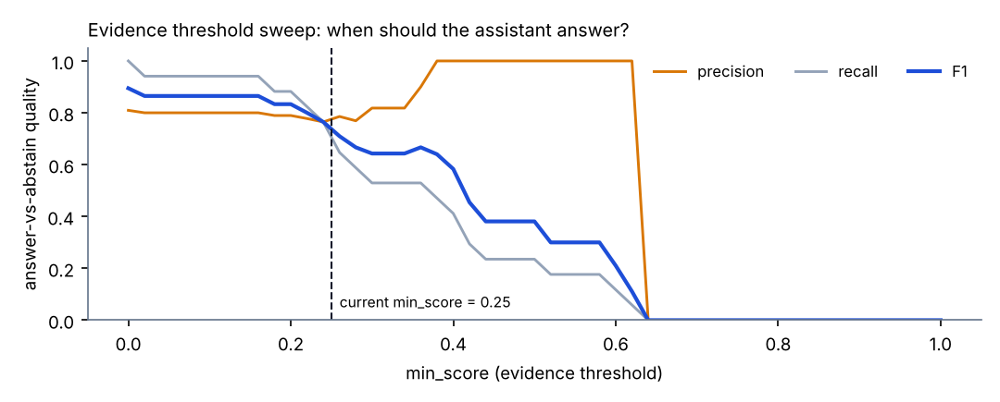
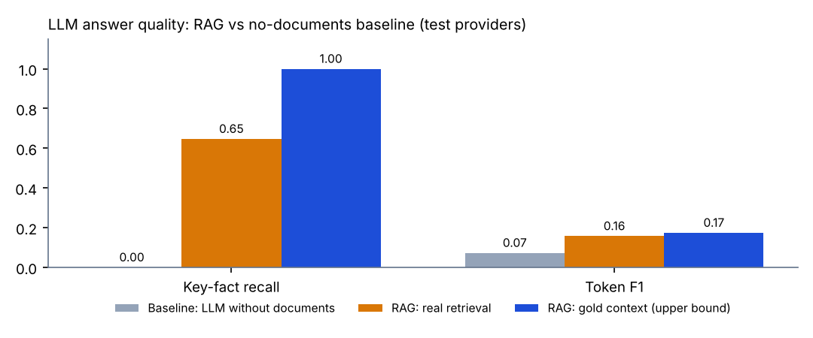
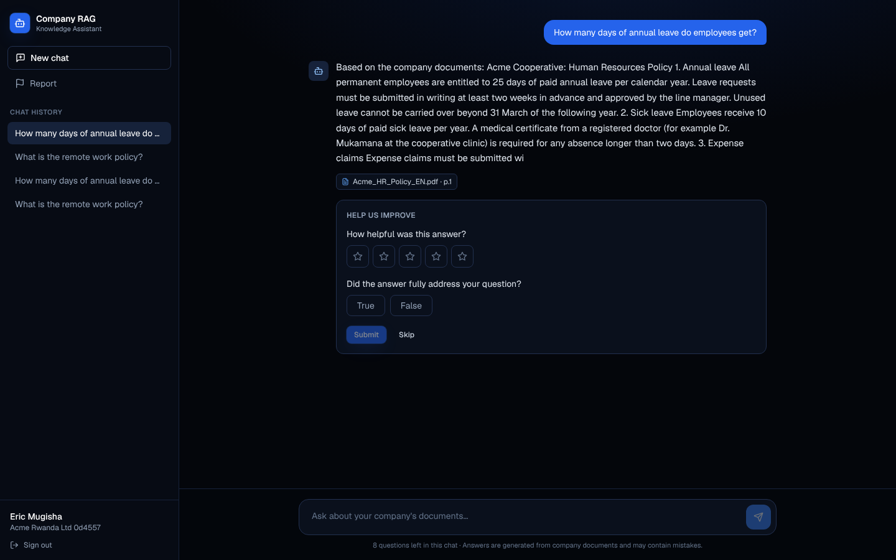
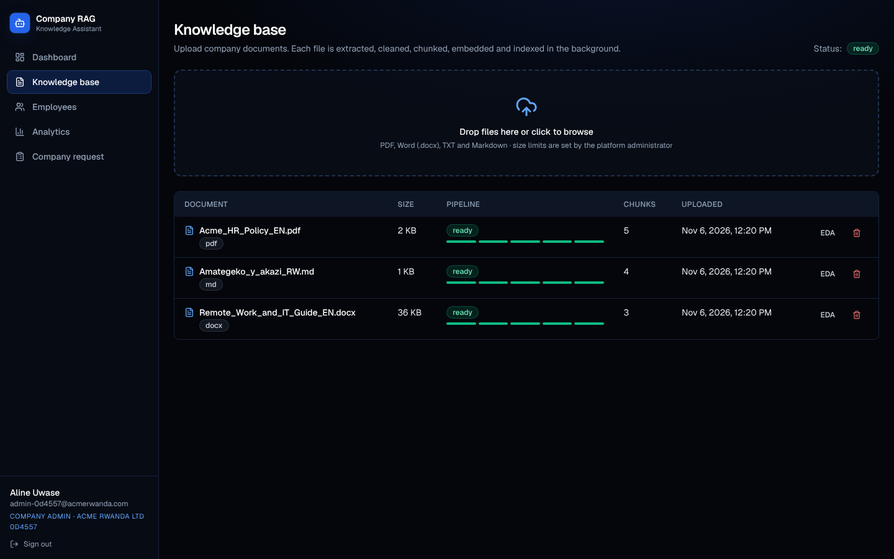
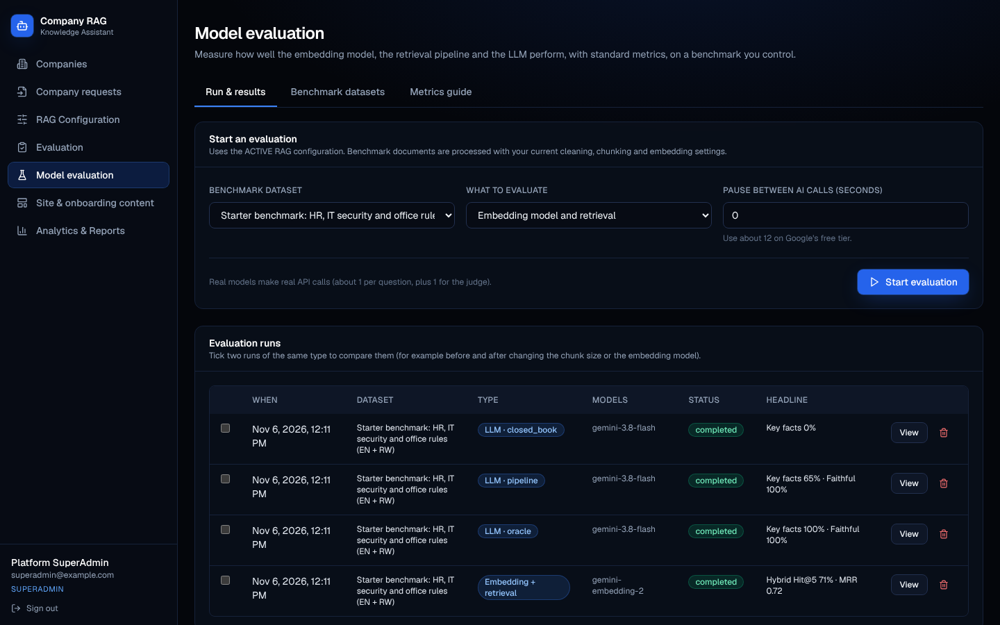
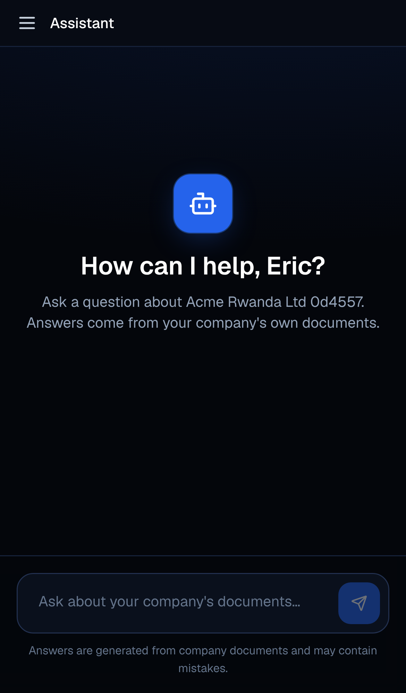

# Chapter 4.5 - Testing and Validation

**Project:** Company RAG Chatbot (multi-tenant, English + Kinyarwanda) - FastAPI, PostgreSQL 16 + pgvector, Next.js 14.
**Evidence folder:** `docs/testing/` (logs, results, screenshots, acceptance kit). Every number below is copied from a file in that folder, and every file can be regenerated with `bash backend/tests/run_all_tests.sh`.

> **Read this first - what is proven and what is still open.** The automated evidence below was produced on a Linux test machine with the system's *test AI providers* (a deterministic embedder and a scripted LLM), so it proves the **software** behaves correctly without needing Google's API. It does **not** measure Gemini's answer quality. Three items must be completed on the author's own hardware before submission and are marked **OPEN**: (1) real-Gemini evaluation runs, (2) Safari / Firefox / physical-device checks, (3) acceptance testing with at least 20 real participants and the SUS survey. Section 4.5.7 explains exactly how.

## 0. Summary of results

| Test level | Tool | Cases | Passed | Failed | Evidence |
|---|---|---|---|---|---|
| Unit | pytest 9.1.1 | 39 | 39 | 0 | `logs/01_unit_tests_pytest.log` |
| Integration - core platform | `smoke.py` over HTTP + PostgreSQL | 51 | 51 | 0 | `logs/03_...` |
| Integration - onboarding, languages, privacy | `smoke_v11.py` | 76 | 76 | 0 | `logs/04_...` |
| Integration - model evaluation lab | `smoke_eval.py` | 40 | 40 | 0 | `logs/05_...` |
| REST interface (success + failure paths) | `rest_interface_samples.py` | 32 | 32 | 0 | `logs/09_...` |
| Browser end-to-end (Chromium) | Playwright | 29 | 29 | 0 | `logs/12_...`, 23 screenshots |
| Data-flow trace (client -> API -> worker -> DB -> LLM -> deletion) | `data_flow_trace.py` | 6 stages | all | 0 | `logs/07_...` |
| Performance / load | `benchmark.py` | 4 scenarios | - | - | `results/benchmark_results_sandbox.json` |
| Model evaluation (ML) | evaluation lab | 21 questions x 4 runs | - | - | `results/eval_results_test_providers.json` |
| **Total automated checks** | | **267** | **267** | **0** | |
| Statement coverage, API code, all suites running | coverage.py 7.17.2 | 2,916 statements | **84%** | | `logs/06_...` |
| Branch coverage, core logic modules, unit tests only | coverage.py | 436 statements | **86%** | | `logs/02_...` |
| Acceptance (SUS, >= 20 participants) | questionnaire | - | **OPEN** | | `acceptance/` kit |

## 4.5.1 Testing environment configurations and error tracking

### A. Environment configurations
| Item | Automated test environment (used for all evidence) | Author's development machine (OPEN: fill in) | Production target (later) |
|---|---|---|---|
| Operating system | Ubuntu 24.04.5 LTS, Linux 6.18 x86_64 | macOS ___ (MacBook ___), Docker Desktop ___ | Render (Linux container) / Vercel |
| CPU / memory | 2 vCPU, 7.8 GB RAM | ___ | Render plan ___ |
| Python | 3.13 (FastAPI 0.162.0, uvicorn 0.54.0, psycopg 3.3.8, pydantic 2.13.5, httpx 0.28.1) | Docker image `python:3.12` | same image |
| Database | PostgreSQL 16.15 + pgvector 0.6.0 | `pgvector/pgvector:pg16` (newer pgvector) | managed PostgreSQL 16 + pgvector |
| Node / front end | Node 22.23.4, Next.js 14.2.35, React 18.3, Tailwind 3.4, TypeScript 5.5 | same via Docker | Vercel |
| Test tooling | pytest 9.1.1, coverage 7.17.2, Playwright with Chromium 153, psutil 7.2.2 | same | - |
| AI providers | **Test providers** (hashing embedder, scripted LLM) | Gemini (`gemini-embedding-2`, `gemini-3.8-flash`) | Gemini |
| Network | Local loopback (no real network latency) | home / campus network | internet |

*Note on pgvector:* version 0.6.0 (test machine) lacks the iterative index scan added in 0.8; the Docker image used for the real system has it. The retrieval code handles both (it tries the setting and continues if it is not supported).

### B. Browser and device matrix
| Browser / device | How tested | Result | Evidence |
|---|---|---|---|
| Chromium 153, Linux desktop, 1440x900 | **Automated** (Playwright): 29 checks, all pages | Pass | `logs/12_browser_e2e.log`, screenshots 01-19 |
| iPhone 13 (Safari-like viewport, touch, UA) | **Emulated** in Chromium | No horizontal scroll, chat usable | screenshots 20, 23 |
| Pixel 7 (Android, Chrome) | **Emulated** in Chromium | No horizontal scroll | screenshot 21 |
| iPad (gen 7) | **Emulated** in Chromium | No horizontal scroll | screenshot 22 |
| Chrome / Safari / Firefox / Edge on macOS or Windows | **OPEN - manual** using the checklist in Appendix C | ___ | add screenshots as `testing/screenshots/manual_<browser>_<page>.png` |
| A real iPhone and a real Android phone | **OPEN - manual**, same checklist | ___ | |
| Low-end vs high-end hardware | Emulated with CPU and network throttling (4.5.6) | See 4.5.6 | `figures/test_frontend_profiles.png` |

Emulation reproduces screen size, touch, user agent, CPU slowdown and bandwidth. It does **not** reproduce Safari's or Firefox's rendering engines, so those two engines are explicitly marked OPEN.

### C. Error tracking
**Logging framework.** Python's standard `logging` module, configured once in `app/main.py` (format `time level logger: message`, level INFO), with named loggers `app`, `security`, `seed`, `eval`. Output goes to standard output, which Docker and Render collect. A search of the code finds no logging call that includes a password, token or API key; API keys are stored encrypted and masked in every response, and audit details must be secret-free.

**Three layers, each with a different audience:**
| Layer | Where | Holds | Who sees it |
|---|---|---|---|
| API error contract | HTTP response | `{"detail": {"code": "...", "message": "..."}}` - a stable code plus a message safe for end users | the user / front end |
| `error_logs` table | PostgreSQL | source (`ingestion`, `llm`, ...), error code, message, **technical detail** (exception text), company | SuperAdmin only, protected by row-level security |
| `audit_logs` table | PostgreSQL | who did what and when (administrative actions such as `company.create`, `documents.upload`, `service.start`, `config.activate`) | SuperAdmin |
| Server log | stdout | stack traces for unexpected exceptions | operator |

**Exception handling.** Unique-key and foreign-key violations become `409 conflict`; any unexpected exception becomes `500 internal_error` with a generic message while the full traceback is logged (`app/main.py`); provider rate limits become `429 rate_limit`; provider failures become `502 ai_failure`; every such failure also writes an `error_logs` row. Messages shown to users are configurable per language by the SuperAdmin.

**Error messages - what the user sees versus what is recorded** (real output of the test run, `logs/09_...` and `logs/10_...`):
| Situation | User sees | Recorded |
|---|---|---|
| Wrong password | `Invalid email or password.` (identical for an unknown email, and a dummy hash is verified so timing does not reveal accounts) | - |
| 6th failed login within 15 minutes | `Too many failed attempts. Please try again in 15 minutes.` (429) | - |
| Corrupt PDF uploaded | `This document could not be processed. Please check the file and try uploading it again.` | `error_logs`: source=`ingestion`, code=`PdfStreamError`, detail=`PdfStreamError('Stream has ended unexpectedly')`; server log: `ERROR app: ingestion/PdfStreamError: job 3c14fca7... failed` |
| Starting the service while a document failed | `The knowledge base is not ready yet.` (409 `kb_not_ready`) | - |
| Missing / forged token | `Authentication required.` / `Invalid authentication token.` (401) | - |
| Employee calls an admin endpoint | `You do not have permission to perform this action.` (403) | - |

**Exception monitoring.** The system has structured logging, an error table and an audit trail, but **no third-party monitoring service** (for example Sentry) and no alerting. Render's log stream is the monitoring surface after deployment. This is listed as future work.

## 4.5.2 Testing objectives
| ID | Objective | Test levels used |
|---|---|---|
| T1 | Prove each core function (cleaning, chunking, language handling, ranking maths, security primitives, configuration validation) is correct in isolation | Unit |
| T2 | Prove every requirement in the project description is met end to end (traceability, 4.5.4) | Validation / integration |
| T3 | Prove tenant isolation: no company can read another's documents, conversations, reports or vectors | Integration, REST |
| T4 | Prove the data pipeline and the privacy deletion (including anonymisation) work and leave nothing behind | Integration, data-flow trace |
| T5 | Prove failures are handled safely: bad input, wrong role, provider failure, corrupt file | REST, unit, browser |
| T6 | Measure latency, throughput and resource use, and find the limits | Performance |
| T7 | Measure the quality of retrieval and of the LLM separately and against baselines | ML evaluation |
| T8 | Prove the UI works across engines, screen sizes and device speeds | Browser, emulation, manual |
| T9 | Prove real users can complete tasks and judge the system usable | Acceptance (OPEN) |

## 4.5.3 Unit testing

**Scope.** Logic that needs no database or network: language detection, language-aware chunking, cleaning (headers/footers, hyphenation, apostrophes, duplicates), extraction errors, Reciprocal Rank Fusion, query handling, the evaluation metrics (every formula checked against hand-computed values), password hashing, JWT creation/expiry/tampering, encryption of API keys, production-safety guards, and configuration range validation.

**Execution summary** (`logs/01_unit_tests_pytest.log`):
```
tests/test_eval_metrics.py::test_threshold_sweep_and_best_threshold PASSED
tests/test_security_and_pipeline.py::test_jwt_tampered_and_expired_are_rejected PASSED
tests/test_security_and_pipeline.py::test_production_refuses_weak_secrets PASSED
tests/test_security_and_pipeline.py::test_config_blocks_validate_ranges PASSED [100%]
============================== 39 passed in 1.03s ==============================
```
| File | Tests | Pass | Fail |
|---|---|---|---|
| `tests/test_language.py` | 9 | 9 | 0 |
| `tests/test_eval_metrics.py` | 9 | 9 | 0 |
| `tests/test_security_and_pipeline.py` | 21 | 21 | 0 |
| **Total** | **39** | **39** | **0** |

**Code coverage (unit tests only, branch coverage on the logic modules)** - `logs/02_unit_coverage_core_modules.log`:
| Module | Statements | Missed | Coverage |
|---|---|---|---|
| `eval/metrics.py` (evaluation formulas) | 105 | 2 | 97% |
| `security.py` (hashing, JWT, encryption) | 45 | 0 | 96% |
| `rag/chunking.py` | 88 | 2 | 95% |
| `rag/clean.py` | 65 | 1 | 95% |
| `rag/extract.py` | 27 | 3 | 86% |
| `rag/lang.py` | 39 | 9 | 74% |
| `rag/retrieval.py` | 67 | 36 | 45% (the missing lines are the SQL search functions, covered by integration tests instead) |
| **Total** | **436** | **53** | **86%** |

**Overall coverage with every suite running against the live API** (`logs/06_...`): **84% of 2,916 statements**. Lowest modules: `rag/extract.py` 41% (PDF branch is exercised by the browser seed, which uploads a real PDF, but coverage was measured before that run), `rag/ai.py` 52% (the Google HTTP adapters cannot run without an API key), `routers/superadmin.py` 63%, `services/mailer.py` 63% (SMTP sending needs a mail server).



**Exception snippet** - a real caught exception from the corrupt-PDF test (`logs/10_api_server_log.log`):
```
2026-11-06 12:13:07,034 WARNING pypdf._reader: EOF marker not found
2026-11-06 12:13:07,034 ERROR app: ingestion/PdfStreamError: job 3c14fca7-... failed | PdfStreamError('Stream has ended unexpectedly')
```
The user-facing result of the same event is in 4.5.1-C.

**Defects found by testing and fixed** (each has a regression check that now runs):
| # | Defect | How found | Fix | Regression check |
|---|---|---|---|---|
| 1 | Create-then-login failed ~4 of 30 times (response sent before the database commit) | repeated scripted runs | function-scoped database dependencies (FastAPI >= 0.121) | 0 of 60 failures after; core suite |
| 2 | Applicants were treated as "company inactive" and blocked | onboarding suite | company-active check only for admin/employee roles | smoke_v11 "applicant can log in" |
| 3 | Up to 7-minute stall when Google was unreachable | manual run without network | only rate-limit errors wait long; others give up after ~7 s | behaviour in `rag/ai.py` |
| 4 | Connection-pool starvation with 10 simultaneous chats | load test | auth dependency no longer holds a connection during the slow AI call | smoke_v11 "12 simultaneous chat requests" |
| 5 | Gemini free-tier 429 errors during upload | real use | longer back-off, `EMBED_PAUSE_SECONDS`, smaller batches | rate-limit path returns 429 + safe message |
| 6 | EDA statistics modal crashed on a nested value | real use | render nested values as text | smoke "EDA stats stored" + browser run |
| 7 | Weak or malformed secrets could reach production | review | startup refuses weak `JWT_SECRET` / missing encryption key | `test_production_refuses_weak_secrets` |
| 8 | Bulk loader in the benchmark was refused: `COPY FROM not supported with row-level security` | benchmark run | loader uses the owner connection; the app role correctly stays restricted | confirms FORCE ROW LEVEL SECURITY is active |

## 4.5.4 Validation testing - requirements traceability

Objectives are taken from the approved project description (section numbers in brackets). Test case IDs: **S**=`smoke.py`, **V**=`smoke_v11.py`, **E**=`smoke_eval.py`, **R**=REST script, **B**=browser, **U**=unit. Names are the exact check names in the logs.

| Req | Objective | Test case(s) | Expected | Actual | Pass? |
|---|---|---|---|---|---|
| R1 | Global RAG config validated before activation; last good config kept [2.1] | S "invalid config rejected (child>=parent)", "config with no API key fails validation and is NOT activated", "previous config still active" | Bad config rejected, old config stays active | Rejected with error; active config unchanged | Pass |
| R2 | API keys never reach the front end [2.1] | S "credential created, key masked", "credential list never returns key"; U `test_api_keys_encrypted_at_rest_round_trip` | Key masked in responses; ciphertext at rest | No key in any response; stored encrypted | Pass |
| R3 | Register companies + initial admin [2.2] | S "company admins login", R "SuperAdmin creates a company" (201), "duplicate admin email -> conflict" (409) | Company and admin created atomically; duplicates refused | Created; duplicate -> 409 | Pass |
| R4 | Activate/deactivate company access [2.2] | S "deactivated company cannot log in" | Users of an inactive company blocked | Login refused, chat 403 | Pass |
| R5 | SuperAdmin can enter company views [2.2] | S "superadmin enters as admin" | Impersonation token works as admin | Admin API returned 200 | Pass |
| R6 | Feedback questions / frequency configurable [2.3] | S "evaluation requested (every answer)", "feedback stored", "wrong feedback type rejected" | Questions shown per setting; types validated | As expected; wrong type -> 422 | Pass |
| R7 | Company admin manages employees [3.1] | S "employee created"; R "create employee" (201), "short password" (422) | Created; weak input rejected | As expected | Pass |
| R8 | Backend enforces company isolation [3.1, 3.2] | S "other company's employee cannot open conversation", "company B admin cannot read A conversation", "company B cannot retrieve company A's documents" | Cross-tenant reads return 404 / no rows | 404; no rows | Pass |
| R9 | Upload + pipeline progress + failure visibility [3.2] | S "upload: md queued, .exe rejected", "duplicate upload detected", "document processed -> ready with chunks", "EDA stats stored", "knowledge base ready"; R corrupt PDF -> failed with safe message | Stages tracked; bad files rejected; failure visible | As expected | Pass |
| R10 | Start / Pause controls [3.3] | S "chat blocked before Start", "start", "paused -> chat blocked, data kept" | Chat only while started; data kept when paused | As expected | Pass |
| R11 | End service = tracked deletion of all data [3.3] | S "END requires confirmation", "deletion completed, all steps done", "documents gone", "conversations gone"; trace stage 6: all counts 0 | Six deletion steps complete; nothing left | All steps done; (0,0,0,0,0) rows left | Pass |
| R12 | Reports, FAQ, evidence indicator, exports [3.4] | S "questions report", "questions CSV download", "feedback list has question+answer", "reports visible to admin", "conversation export csv" | Reports and CSV exports available | As expected | Pass |
| R13 | Employee login, chat, follow-ups [4.1] | S "answer grounded with evidence + sources"; B "English question answered through the UI" | Grounded answer with sources | Answer + source chip shown (screenshot 05) | Pass |
| R14 | Maximum 9 exchanges, enforced by backend [4.1] | S "10th question blocked by backend (limit 9)", "exchange_count capped at 9"; U `test_config_blocks_validate_ranges` | 10th question refused with 409 | Refused; count stays 9 | Pass |
| R15 | Chat UI: sidebar, history, report, progress indicator [4.2] | B employee flow; screenshots 04-07 | New chat, history, report form visible | Visible and working | Pass |
| R16 | Ratings and reports stored with references [4.3] | S "feedback stored", "report submitted"; trace stage 5 | Rows linked to company, user, message | Linked rows found in DB | Pass |
| R17 | Workflow: authenticate, validate, embed, retrieve, rank, generate, record [5] | trace stages 3-5 (retrieval_logs with dense, sparse and fused scores) | Evidence trail stored per answer | `retrieval_logs` rows with all three scores | Pass |
| R18 | No-evidence path does not invent an answer [5] | S "no-evidence question uses no-evidence path" | Polite "not found" answer, `has_evidence=false` | As expected | Pass |
| R19 | Kinyarwanda: detect, answer in Kinyarwanda, cross-language [supervisor] | V "Kinyarwanda question: language detected, evidence found, answered in Kinyarwanda", "English question finds the KINYARWANDA document", "no-evidence answer comes back in Kinyarwanda"; U language tests | Right language in, right language out | As expected (test providers) | Pass* |
| R20 | Company request + approval workflow [supervisor] | V 14-40: one open request, needs-info loop, reject/resubmit, approve, onboarding locked until approval, company created only after terms accepted | Full workflow incl. emails queued | 76 of 76 checks | Pass |
| R21 | Versioned terms with acceptance record [supervisor] | V "editing terms publishes a NEW version", "accepting an outdated terms version is refused", "acceptance audit trail stored" | Immutable history | As expected | Pass |
| R22 | Content, form fields and languages are data, not code [supervisor] | V "landing content editable", "form field added in the database", "a new language is just data (Swahili added)", "English cannot be deleted" | Changes without redeploy | As expected | Pass |
| R23 | Privacy: employees deleted, only anonymised scores kept [supervisor] | V "employee account deleted", "anonymised table has no company/user/text columns", "report comment text was deleted with the company" | No personal or company text retained | As expected | Pass |
| R24 | Switching embedding model re-processes documents [supervisor] | V "changing the embedding model re-queues existing documents", "documents re-embedded with the new model", "chat still works after the model switch" | Vectors from different models never mixed | As expected | Pass |
| R25 | Model evaluation lab [added scope] | E 40 checks (datasets, runs, metrics bounds, baselines, CSV export, access control) | Metrics valid and reproducible | 40 of 40 | Pass |
| R26 | Security: roles, tokens, passwords, brute-force limit | R 401/403 cases and 6th-attempt 429; U security tests; B "protected page redirects to /login", RBAC redirects | Unauthorised access refused; repeated failures throttled | As expected | Pass |
| R27 | Responsive UI and favicon [added scope] | B emulated devices, favicon assets 200 | No horizontal scroll; icons served | As expected | Pass |
| R28 | Real-model answer quality in both languages | evaluation lab with Gemini | Key-fact recall and language match acceptable | **OPEN** (needs the author's API key) | Open |

\* Passes with the test providers; the real multilingual embedding must be confirmed with the Language check and an evaluation run.

## 4.5.5 Integration testing

### REST interface testing (expected vs actual)
Output of `tests/rest_interface_samples.py` (`logs/09_...`): 32 requests, 32 behaved as specified. Selected rows:

| Case | Request | Expected | Actual | Time |
|---|---|---|---|---|
| Login | `POST /auth/login` | 200 | 200 | 142 ms |
| Wrong password | `POST /auth/login` | 401 | 401 `invalid_credentials` | 139 ms |
| 6th failed login (brute-force guard: 5 failures per 15 min per address + email) | `POST /auth/login` | 429 | 429 `too_many_attempts` | 2 ms |
| Malformed email | `POST /auth/login` | 422 | 422 | 2 ms |
| No token | `GET /superadmin/companies` | 401 | 401 `not_authenticated` | 2 ms |
| Forged token | `GET /superadmin/companies` | 401 | 401 `invalid_token` | 1 ms |
| Create company | `POST /superadmin/companies` | 201 | 201 | 161 ms |
| Duplicate admin email | `POST /superadmin/companies` | 409 | 409 `conflict` | 146 ms |
| Company Admin calls SuperAdmin API | `GET /superadmin/companies` | 403 | 403 `forbidden` | 3 ms |
| Employee calls Admin API | `GET /company/employees` | 403 | 403 | 3 ms |
| Short password | `POST /company/employees` | 422 | 422 `string_too_short` | 4 ms |
| Upload valid + unsupported file | `POST /company/documents` | 202 | 202 (md queued, exe rejected) | 10 ms |
| Start while a document failed | `POST /company/service/start` | 409 | 409 `kb_not_ready` | 4 ms |
| Chat before Start | `POST /chat/conversations/{id}/messages` | 403 | 403 `service_unavailable` | 3 ms |
| Empty question | same | 422 | 422 | 2 ms |
| Unknown conversation | `GET /chat/conversations/{id}` | 404 | 404 | 3 ms |
| End without confirmation | `POST /company/service/end` | 422 | 422 | 3 ms |

The same endpoints are in the Postman collection (`postman/`) and the interactive Swagger page at `/docs`.

### Data flow, client -> backend -> database
`tests/data_flow_trace.py` follows one document and three questions through the whole system and prints the database state at every step (`logs/07_data_flow_trace.log`). Key evidence:
```
[03] POST /company/documents -> HTTP 202 ; worker: upload 0% -> done 100%
     DB documents: [('handbook.md', 'ready', 'gemini-embedding-2', 211)]
     DB parent_chunks / chunks: [(2, 2)] ; stored vector dimension: [(768,)]
     DB chunk languages: [('en', 1), ('rw', 1)]
[04] Q: How many days of annual leave do employees get?   lang=en has_evidence=True remaining=8
     DB retrieval_logs (evidence trail): rank 1 dense 0.533 sparse 0.800 fused 0.0328 used_in_prompt=True
[06] deletion job: completed {logs, files, vectors, database, anonymize, temp_files: done}
     DB rows left for the company (documents, chunks, conversations, messages, employees): [(0,0,0,0,0)]
     DB anonymised_feedback keeps only: scores and report category (no company, user or text)
```
Integration checks also cover the background worker (job queue claimed with `FOR UPDATE SKIP LOCKED`), tenant isolation at two layers (explicit `company_id` filter plus row-level security), and the pool-starvation regression (12 simultaneous chats).

**An observation worth stating.** In stage 4 of the trace, the out-of-scope question ("Who won the football match yesterday?") still found "evidence". That is a property of the *test embedder* (a bag-of-words hash always finds some overlap), and is exactly what the no-answer threshold analysis in the evaluation lab exists to calibrate. The no-evidence path itself is verified separately (R18).

## 4.5.6 Functional and system testing

### Performance (API, 2 vCPU / 7.8 GB machine, test AI providers so Google's response time is excluded)
Source: `results/benchmark_results_sandbox.json`, `logs/08_benchmark_run.log`.

| Scenario | Result |
|---|---|
| Login (Argon2 hashing is deliberately slow) | p50 110 ms, p95 154 ms |
| Chat, one user, 40 requests | p50 153 ms, p95 209 ms, 0 errors |
| Chat, 10 simultaneous users, 30 requests | p50 786 ms, p95 1,041 ms, **9.8 requests/s**, 0 errors |
| Ingestion of a 0.92 MB document | 7,363 chunks in 16.1 s (457 chunks/s): extract > clean > chunk > embed > index |
| Vector search (HNSW), 5,000 / 20,000 chunks | p50 1.8 ms / 2.1 ms |
| Keyword search (GIN), 5,000 / 20,000 chunks | p50 4.9 ms / 9.4 ms |
| Bulk load of vectors | 5,000 chunks in 35 s; 20,000 in 130 s |



| Resource use | CPU mean / peak | API process memory | System memory peak |
|---|---|---|---|
| Idle | - | 281 MB | - |
| During ingestion | 50% / 62% | 379 MB peak | 1,190 MB |
| 10 simultaneous chat users | 86% / **100%** | 221 MB | 1,062 MB |

*Findings.* (1) With real Gemini, an answer will take the model's response time (typically seconds) on top of the roughly 150 ms of system time measured here. (2) At 10 simultaneous users the two CPU cores saturate (peak 100%) and p50 rises about five times; capacity is CPU-bound, and a larger Render instance or more workers is the remedy. (3) Memory stays under 400 MB for the API. (4) HNSW recall@10 measured on random vectors was 0.71 (5,000) and 0.89 (20,000) with pgvector 0.6.0 and default settings; real text embeddings cluster better, and `ef_search` can be raised if recall matters more than speed. **Limits not tested:** more than 10 simultaneous users, more than 20,000 chunks, and soak tests over hours.

### Cross-browser and cross-device (Chromium, emulated profiles, cold load, median of 3)
| Page | Desktop | Mid-range phone (4x CPU slowdown, 4G) | Low-end phone (6x CPU slowdown, slow 3G) |
|---|---|---|---|
| Landing | load 94 ms, LCP 180 ms | 839 ms, 1.2 s | 7.0 s, 7.4 s |
| Login | 88 ms, 84 ms | 820 ms, 0.6 s | 6.2 s, 1.7 s |
| Chat (signed in) | 85 ms, 128 ms | 811 ms, 1.1 s | 7.0 s, 7.0 s |
| Model evaluation (SuperAdmin) | 86 ms, 168 ms | 788 ms, 1.1 s | 6.6 s, 6.6 s |



*Findings.* Pages are fast on desktop and acceptable (about 1 s to largest paint) on a mid-range phone. On a slow 3G connection first load takes about 7 s, because the first visit downloads roughly 140 kB of JavaScript over a 400 kbit/s link; repeat visits are cached. This is recorded as a known limitation and a candidate improvement (lazy-load the chart and markdown libraries). A complete chat round trip through the UI took 79 ms with the test providers. FPS testing does not apply (no animation-heavy or XR content). The single console error in the run is the deliberate 401 from the wrong-password test.

### Machine-learning comparison
Details and definitions: `MODEL_EVALUATION_METRICS.md`. Starter benchmark (21 questions: 17 answerable, 4 not answerable; English and Kinyarwanda), **test providers - the real Gemini run is OPEN**.



| Retrieval method | Hit@5 | Hit@10 | MRR | nDCG@10 | p50 latency |
|---|---|---|---|---|---|
| Keyword only (baseline) | 0.71 | 0.71 | 0.71 | 0.71 | 0.5 ms |
| Embedding only | 0.65 | 0.88 | 0.67 | 0.72 | 1.2 ms |
| **Hybrid, RRF (system)** | **0.71** | **0.88** | **0.72** | **0.76** | ~1.7 ms (sum) |

Precision, recall and F1 appear in the **answer-or-abstain** decision, where *answerable* is the positive class (precision = answered questions that were truly answerable; recall = answerable questions that were answered):



| Setting (test embedder) | Precision | Recall | F1 |
|---|---|---|---|
| Current `min_score` 0.25 | 0.76 | 0.76 | 0.76 |
| Suggested by the sweep (0.00, i.e. no threshold helps) | 0.81 | 1.00 | 0.89 |

The test embedder cannot separate answerable from unanswerable questions (mean best score 0.354 vs 0.320), which the tool reports honestly; with a real model this curve should show a clear peak.



| LLM mode | Key-fact recall | Token F1 | Faithfulness |
|---|---|---|---|
| Baseline: no documents (closed-book) | 0.00 | 0.07 | - |
| RAG, real retrieval | 0.65 | 0.16 | 1.00 |
| RAG, gold context (upper bound) | 1.00 | 0.17 | 1.00 |

**Trade-offs and comparison with existing practice.** There is no published benchmark for this company-specific corpus, so the comparison is against (a) baselines inside the system (above) and (b) published design guidance. The BEIR benchmark study (Thakur et al., 2021) found keyword search (BM25) a robust baseline that dense retrievers often fail to beat outside their training domain, which is why systems commonly fuse lexical and dense rankings; Reciprocal Rank Fusion (Cormack, Clarke and Buettcher, 2009) is a parameter-light way to do that. The results above are consistent with that reasoning (hybrid is at least as good as either method on MRR and nDCG at +1 ms), but with 17 questions the 95% intervals are wide (for example Hit@5 0.71 has an interval of 0.47-0.87), so **the difference between methods is indicative, not statistically established**.
| Choice | Benefit | Cost |
|---|---|---|
| Hybrid instead of embedding-only | Catches exact terms (names, numbers, Kinyarwanda words) and meaning | One extra query (about 0.5-5 ms) |
| Parent-child chunks | Precise search on small chunks, fuller context for the LLM | More tokens per question; no gain when documents are short |
| Higher `min_score` | Fewer invented answers | More "not found" for valid questions |
| `gemini-embedding-2` (multilingual) | Cross-language retrieval | Vectors are not comparable with other models: switching re-processes all documents |

## 4.5.7 Acceptance testing  -  **OPEN: requires real participants**

**Protocol.** Cohort: at least **20 real participants** (or a cohort approved in writing by the supervisor if the system's niche audience is small), drawn from the intended users: employees and administrators of a company or organisation, plus Kinyarwanda speakers. Each participant signs informed consent, receives a test account in a throwaway demo company with the demo documents, completes the task list (about 15 minutes; Employee tasks 1-8, Admin tasks 1-6), then fills in the SUS questionnaire and the project survey. No personal data other than role, device and browser is recorded; participants are identified as P01, P02, ... Everything is in `docs/testing/acceptance/`:

| File | Purpose |
|---|---|
| `sus_questionnaire.md` | The 10 SUS statements, the scoring rule, 5 project survey questions, 2 open questions, the task list |
| `responses_template.csv` | One row per participant (copy to `responses.csv`) |
| `sus_score.py` | Computes SUS per participant, cohort mean, median, 95% interval, grade, per-role means, survey means and agreement share, task completion; draws `sus_chart.png` |

**Analysis method.** SUS = sum of the ten adjusted answers x 2.5 (0-100; 68 is the commonly cited average, above 80 is excellent). Report the mean with its 95% interval, the share of participants at or above 68, the survey agreement shares (answers 4 or 5), task completion and time, and the three most frequent problems from the open answers, with the fix made for each.

**Results (fill after testing).**
| Measure | Value |
|---|---|
| Participants (target >= 20) | ___ |
| Employees / Company Admins | ___ / ___ |
| SUS mean (95% interval) | ___ (___ - ___) |
| Share at or above 68 | ___ |
| Mean tasks completed of 8 / mean minutes | ___ / ___ |
| S1 answers matched the documents (agree 4-5) | ___ |
| S2 English and Kinyarwanda worked (agree 4-5) | ___ |
| Top three problems found and fixes made | ___ |

Attach the raw `responses.csv` and `sus_chart.png` as **Appendix B (user testing report and raw data)** and cite it here. *No participant data exists yet; none has been invented.*

## Appendix A - Screenshot evidence index
Captured automatically from the running application (Chromium, test providers) into `docs/testing/screenshots/`. The answers visible in screenshots 05-06 are from the **test LLM**; **re-capture 05, 06, 15 and 19 with real Gemini before submitting** so they show real answers and metrics.

| File | What it proves |
|---|---|
| `01_landing_desktop`, `23_landing_iphone13_emulated` | Public site, responsive |
| `02_login`, `03_login_error` | Sign-in and the safe error message |
| `04_employee_chat_empty` .. `07_employee_report_form` | Employee chat, answer with source chip and feedback prompt, Kinyarwanda answer, report form |
| `08_admin_dashboard` .. `11_admin_analytics` | Company Admin: dashboard, documents and processing, employees, analytics |
| `12_superadmin_companies` .. `18_superadmin_feedback_settings` | SuperAdmin: companies, requests, RAG configuration, Model evaluation, content, analytics, feedback settings |
| `19_model_evaluation_run_detail` | Full metric breakdown of one evaluation run |
| `20-22_chat_*_emulated` | iPhone 13, Pixel 7, iPad layouts |

Key screenshots:









**Terminal evidence to capture on your own machine (OPEN):** screenshots of `pytest` (39 passed), the three smoke suites (51 / 76 / 40 passed), the coverage report, and `benchmark.py` output, saved as `testing/screenshots/terminal_<name>.png`. The text logs in `testing/logs/` are the same output; a screenshot from your own machine proves you ran them.

## Appendix B - How to reproduce
```
cd backend && bash tests/run_all_tests.sh          # unit + integration + REST + trace + ML runs + coverage (throwaway stack only)
python tests/e2e_browser.py ../docs/testing/screenshots   # browser tests (API on :8000, front end on :3000)
BENCH_OUT=../docs/testing/results/benchmark_results_mac.json python tests/benchmark.py --part all    # run on your MacBook too
python docs/testing/acceptance/sus_score.py docs/testing/acceptance/responses.csv
python docs/report/build_figures.py                # redraw every chart from the result files
```
These scripts switch the global AI configuration to test providers and create test companies: use a throwaway stack (`docker compose down -v`), never your real data.

## Appendix C - Manual browser and device checklist (OPEN)
Repeat on Chrome, Safari, Firefox and Edge (desktop) and on one real iPhone and one real Android phone. Record Pass/Fail and take one screenshot per browser of step 6.
1. Landing page loads; switch language EN <-> Kinyarwanda. 2. Tab icon (favicon) shows. 3. Sign in as Employee. 4. Ask an English question; answer and source chip appear. 5. Ask a Kinyarwanda question. 6. Rate the answer and send a report. 7. Sign in as Company Admin: upload a PDF, watch the progress, add an employee. 8. Sign in as SuperAdmin: open RAG settings and Model evaluation. 9. Rotate the phone; no horizontal scrolling; text readable. 10. Sign out; the Back button does not show private pages.

## Appendix D - Known limitations of this test campaign
- Test AI providers were used; semantic quality and real answer quality are unmeasured until the Gemini runs are done.
- Only the Chromium engine is automated; Safari and Firefox rendering and real devices are unverified.
- The front end has end-to-end tests but no component-level unit tests.
- Load was tested up to 10 simultaneous users on 2 vCPUs; larger scale is unknown.
- No external exception-monitoring service or alerting.
- The starter benchmark has 21 questions, so quality differences of a few points are not statistically meaningful.
- Acceptance testing has not been performed.
